# NoteZero


**Offline-first, end-to-end encrypted notes and code editor for Android.**
No account. No cloud. No network permission. Your notes never leave the device except
through an encrypted backup file you export yourself.

NoteZero is the second Cipherwell app, built to the same security bar as
[VaultZero](https://github.com/cipherwell/Vault-Zero) with an independent package
(`com.cipherwell.notezero`), independent signing key and independent threat model.

> Status: **Phase 5 — all-in-one workspace (increment 10)** — 2026-11-17.
> Security core, notes MVP, encrypted SAF backup/restore, code editor (workspace
> search/copy/export/indent), encrypted attachments (images/files/**drawings**),
> **locked notes/folders**, **Markdown/HTML/PDF note export**, **table editing**,
> **quick-capture launcher shortcut**, a **create menu (Note / Drawing / Code / PDF)**,
> **blank encrypted PDF documents**, a **quick-note home-screen widget**, and now a
> **Library** with **encrypted EPUB/PDF readers**: document import (EPUB 2/3 + PDF),
> table of contents, in-book search, bookmarks, paper/sepia/night themes with typography
> controls, page navigation, and an **encrypted reading state** (position, progress,
> bookmarks) that survives lock/unlock, backup and restart. The product direction and
> phased plan (PDF annotation, drawing studio, universal file workspace, more formats) are
> in [docs/ROADMAP-ALL-IN-ONE.md](docs/ROADMAP-ALL-IN-ONE.md), grounded in
> [docs/RESEARCH-ALL-IN-ONE-2026-11-17.md](docs/RESEARCH-ALL-IN-ONE-2026-11-17.md).
> Builds are green, **1068 unit tests + 15 device tests**, and **signed APK + AAB release
> builds are byte-for-byte reproducible**; an independent security audit previously found
> no HIGH/CRITICAL issues and its findings are remediated. Device QA on a Pixel 9 Pro XL
> (Android 17) and the emulator covered import, TOC, search, bookmarks, themes and
> resume-after-lock. Evidence: [docs/VERIFICATION-2026-11-15.md](docs/VERIFICATION-2026-11-15.md).


## What exists today

| Setup (first run) | Unlock | Notes MVP |
|---|---|---|
|  | 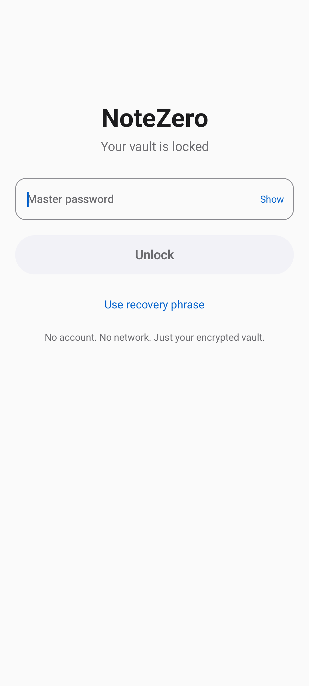 | 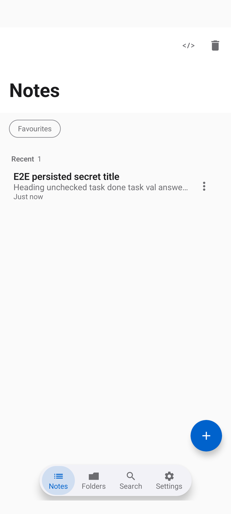 |
| **Markdown editor** | **Block preview (checklists tap to toggle)** | **Second note persisted** |
|  | 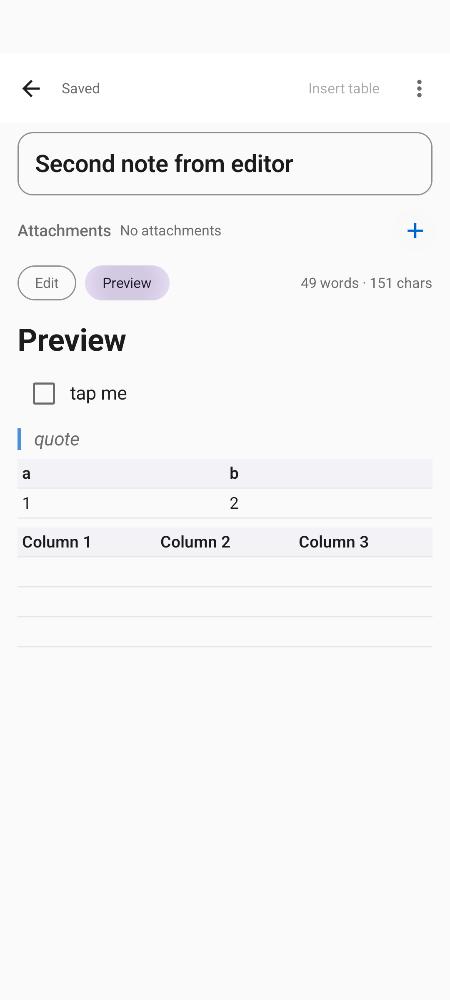 | 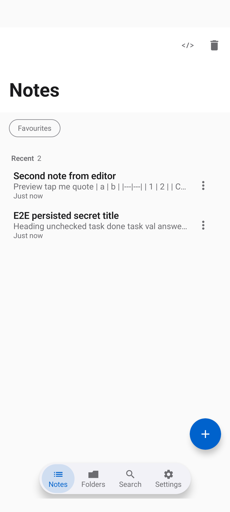 |
| **Encrypted backup (SAF)** | **Code workspace (file tree)** | **Kotlin editor (syntax highlighting)** |
| 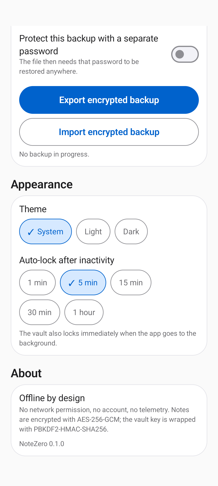 | 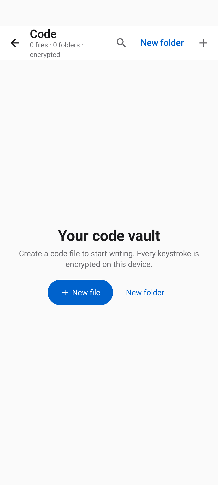 |  |
| **Encrypted attachments in the editor** | **Workspace-wide search** | **Search result opens at the line** |
|  |  | 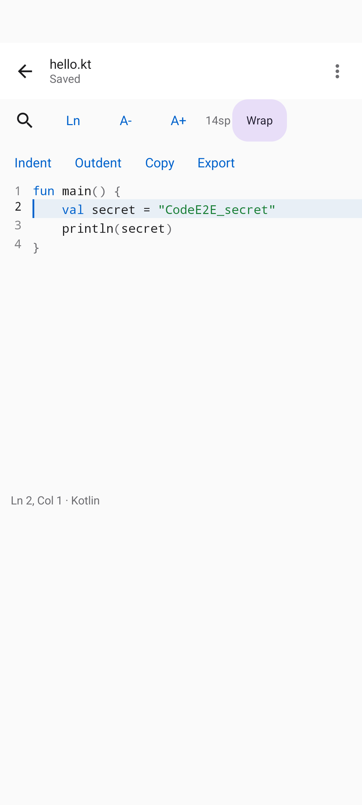 |
| **Insert markdown table** | **Drawing canvas (encrypted PNG)** | **Quick capture shortcut** |
| 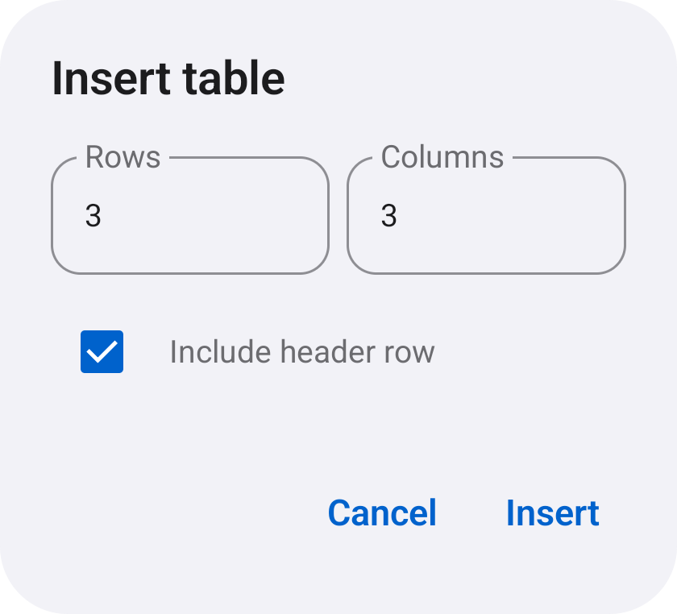 | 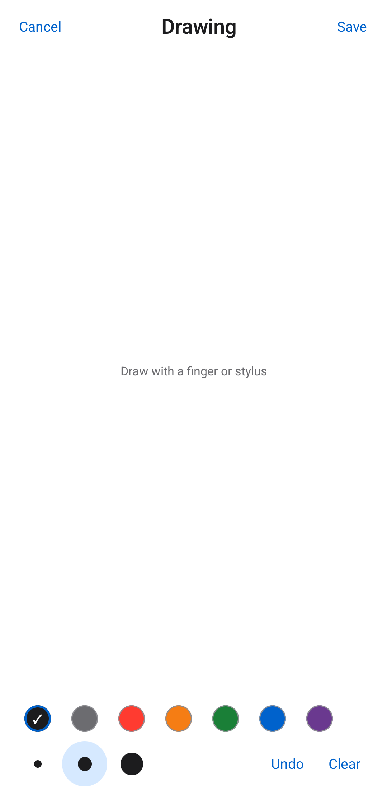 | 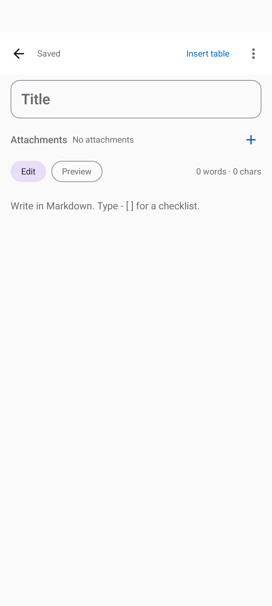 |
| **Locked note masked in the list** | **Re-auth with master password** | **Revealed after verification** |
|  | 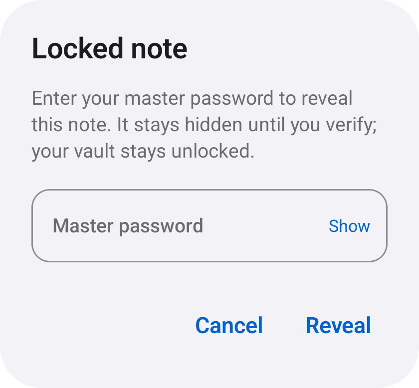 |  |
| **Create menu: Note / Drawing / Code / PDF** | **Blank PDF document viewer** | **Export note as PDF** |
| 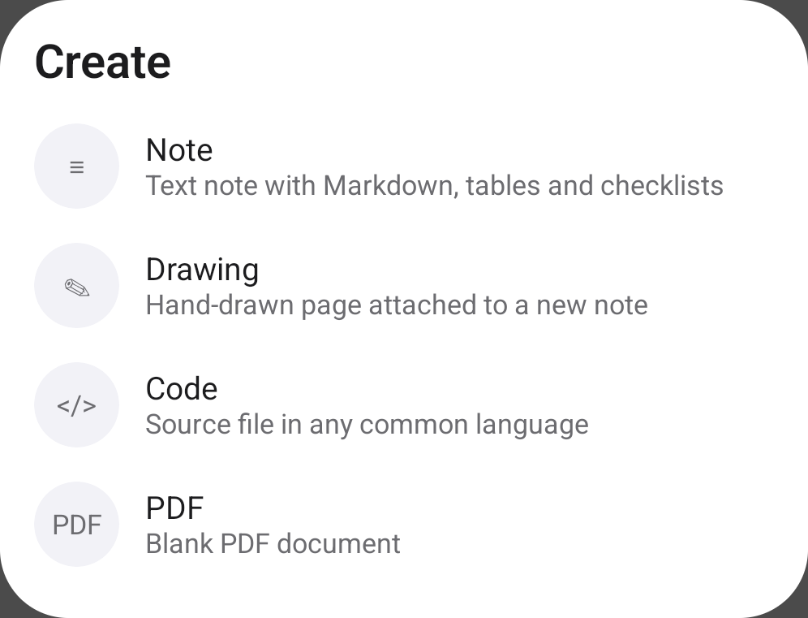 |  | 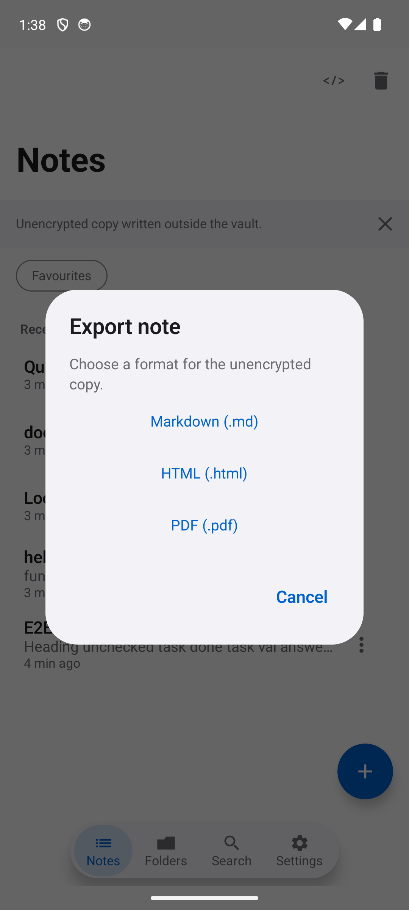 |
| **Home-screen quick-note widget** | **Device status bar (light)** | **Device drawing at 1.15 font** |
|  |  |  |
| **Library (books, PDFs, drawings)** | **EPUB reader (TOC/search/bookmarks)** | **PDF reader tools (progress/bookmarks)** |
| 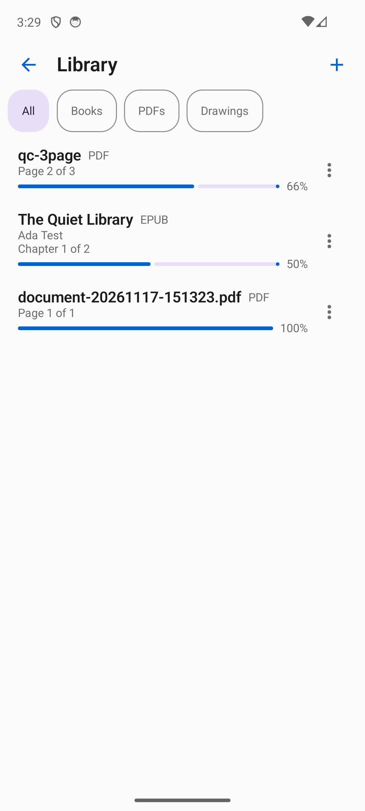 |  |  |
| **Night reading theme + encrypted bookmarks** | | |
|  | | |

Screenshots are real emulator captures from the instrumented E2E run (debug build with
`-PallowScreenshots=true`; normal builds set FLAG_SECURE, which makes `screencap` return a
0-byte file — verified).

## All-in-one reading (2026-11-17)

- **Library**: one encrypted shelf for PDFs, EPUB books and drawings; import through SAF
  (MIME-tolerant picker with parser validation), progress/Continue, rename/lock/trash rules
  shared with notes, masked items never listed.
- **EPUB engine**: dependency-free EPUB 2/3 parser (ZIP + XML, XXE-off, bounded entries,
  DRM refused, no scripts/CSS), native Compose rendering (headings, inline styles, lists,
  quotes, code, images), rendered entirely in memory — no plaintext cover/cache.
- **Reader tools**: TOC, in-book search (1-result verified on device), bookmarks, font
  size/line spacing/margins, paper/sepia/night themes (night code-block contrast fixed
  during device QA), tap zones and progress.
- **PDF tools**: page slider/jump, bookmark add/list/delete, resume position, with the
  existing encrypted-attachment and SAF export rules unchanged.
- **Encrypted reading state** (`ItemCodec` payload v4): position, fraction, total, bookmarks
  and book author/language live inside the AES-GCM item envelope and travel with backup v2;
  repository-owned so autosave cannot roll them back.
- **Measured QA** (emulator, Android 17 image): imported a 2-chapter EPUB (title/author/TOC/
  image/search/bookmark/night theme), imported a 3-page PDF (page jump, bookmark at 66%
  `Page 2 of 3`), killed and relaunched the app + re-unlocked the vault, confirmed bookmarks
  and positions persisted; 1068 unit tests / 0 failures (91 classes) and 15 instrumented
  tests green.

## Verified end to end (2026-11-15)

- 913 unit tests / 0 failures (79 classes); 15 instrumented tests on a real emulator.
- Real Android crypto: setup → BIP-39 phrase → lock/unlock; **password change leaves note
  ciphertext byte-identical**; recovery reset invalidates the old password; a raw SQLite scan
  of the database files (main + WAL + SHM) finds no plaintext title/body/phrase — including a
  code file created through the code editor.
- SAF encrypted backup/restore is wired end to end: the picker's background stop no longer
  locks the vault (deferred, idle timeout still applies), exports are vault-key or
  separate-password protected, imports are duplicate-safe and accept a source master password
  or 12-word phrase for cross-vault restores.
- Code editor: pure-Kotlin lexers for Kotlin/Java/JS/TS/Python/JSON/XML/Markdown/Shell
  (200 KB in ~3–8 ms measured), file tree, line numbers, syntax colours, auto-indent,
  bracket matching, find/replace, go-to-line, undo/redo, font size/wrap, 600 ms autosave,
  workspace-wide search that opens a file at the matched line, sensitive-flagged copy and an
  explicit-warning decrypted export.
- Attachments: images and files imported through the Photo Picker / SAF, encrypted at rest in
  app-private storage as AES-256-GCM blobs (`NZAT` v1) under the vault VMK with AAD bound to
  note id + attachment id, SHA-256 verified on read, 10 MiB/file, 100/note, 512 MiB quota;
  in-memory thumbnails only (no plaintext cache); decrypted export only behind an explicit
  "writes an UNENCRYPTED copy" confirmation. Backups (v2) carry the attachment bytes.
- **PDF export**: the note row menu exports an unencrypted **PDF (.pdf)** alongside Markdown
  and HTML, through the same explicit "writes an UNENCRYPTED copy" warning + SAF
  `CreateDocument` flow. Rendering happens entirely in memory (`android.graphics.pdf`) into A4
  pages with styled headings, bold/italic/inline-code/links, lists, checklists, fenced code,
  quotes, tables and page numbers; the bytes go straight to the user-chosen file and are never
  cached. Large documents are bounded (input/page/table caps) and renderer failure maps to the
  existing non-secret export error.
- **Quick-note widget**: a static home-screen tile ("New note") that launches quick capture
  through the same `SHORTCUT_NEW_NOTE` request as the launcher shortcut. The widget shows **no
  vault content** (counts/titles/body) because home screens are visible while locked; it is
  never polled (`updatePeriodMillis=0`), the receiver is not exported and the PendingIntent is
  immutable.
- **Create menu**: the Notes "+" opens a sheet to create a **Note** (Markdown), a
  **Drawing** (editor opens with the canvas ready), a **Code** file (name + picker with 27
  well-known extensions: `.txt .md .html .css .js .ts .json .xml .yml .toml .py .kt .java .c
  .cpp .h .cs .go .rs .rb .php .swift .sql .sh .csv .ini .properties`; a typed known extension
  wins, formats without a lexer edit as plain text rather than mis-highlighted) or a **PDF**
  (blank one-page document stored as an encrypted `application/pdf` attachment and rendered by
  the platform PDF viewer; export only behind the explicit decrypted-copy warning).
- Locked notes/folders: the lock flag lives inside the encrypted envelope; locked content is
  masked in lists/search/counts and in the code workspace until re-authenticated with
  biometrics or the master password (presence gate, not a second encryption layer — content
  stays AES-256-GCM under the VMK). Verification is memory-only, wiped on background/lock;
  master-password re-auth is rate-limited. Backup/restore preserves lock flags but never
  verification.
- **Reproducible release builds**: `scripts/verify-reproducible.sh` rebuilds the same commit
  twice in different directories with a pinned `SOURCE_DATE_EPOCH` and no build cache; the
  signed **APK and AAB are both byte-identical** (methodology/limits:
  docs/REPRODUCIBLE-BUILDS.md), and CI enforces the unsigned check on every push.
- **Audited**: independent adversarial audit of crypto/storage/session/offline surface found
  **0 HIGH / 0 CRITICAL**; 2 MEDIUM + 8 LOW findings all remediated (report:
  docs/AUDIT-2026-11-15-phase5.md). All UI strings are in Android resources (translation-ready).
- **Drawing canvas**: in-memory PNG drawings imported as encrypted attachments (no plaintext
  cache, same 10 MiB pipeline). **Note export**: explicit-warning SAF Markdown/HTML export with
  a fully escaped HTML renderer. **Tables**: insert-table dialog + row/column edits on the
  Markdown table under the caret. **Quick capture**: launcher shortcut that survives a locked
  vault and creates the note only after unlock, through the encrypted repository.
- FLAG_SECURE default-on proof; release APK permission dump: only `USE_BIOMETRIC` (+
  androidx.core's signature-level receiver guard) — no network, camera, location or storage.
- Signed release verified with the independent NoteZero upload key; unsigned-release fallback
  for F-Droid also verified.
- Full evidence trail incl. commands and hashes:
  [docs/VERIFICATION-2026-11-15.md](docs/VERIFICATION-2026-11-15.md).

## Security properties (by construction)

- **No network permissions.** `INTERNET` and `ACCESS_NETWORK_STATE` are stripped from the
  merged manifest with `tools:node="remove"` (plus the deprecated `USE_FINGERPRINT` the
  biometric library drags in), no network library is a dependency, and
  `scripts/check-offline.sh` + `OfflineGuaranteeTest` fail the build if that changes.
  The only app permission left is `USE_BIOMETRIC` plus `androidx.core`'s signature-level
  dynamic-receiver guard.
- **Random 256-bit vault master key (VMK).** Notes are AES-256-GCM encrypted under the
  VMK; the VMK is only ever wrapped by your password/recovery phrase, never derived from
  them. Changing the master password re-wraps the VMK and does **not** re-encrypt notes.
- **Per-item AAD.** Every ciphertext is bound to its item id and type, so a row cannot be
  swapped between notes/vaults without failing authentication.
- **Redacted storage.** Titles, tags, folder names, bodies and flags live *inside* the
  encrypted envelope. Room columns hold only random ids, kinds, timestamps and ciphertext.
- **PBKDF2-HMAC-SHA256, 600,000 iterations**, 128-bit salts, versioned KDF slot so
  Argon2id can be added without breaking existing vaults.
- **12-word BIP-39 recovery phrase** (128-bit entropy, checksum validated, unique words).
- **Hardware biometric unlock** via Android Keystore, per-use CryptoObject, invalidated by
  re-enrolment.
- **Auto-lock** on background/screen-off/timeout; sensitive clipboard handling; FLAG_SECURE.
- **Encrypted backup** export/restore through the Storage Access Framework only.
- **No telemetry, analytics, ads, accounts or third-party sync.**

See [docs/CRYPTO-SPEC.md](docs/CRYPTO-SPEC.md), [docs/THREAT-MODEL.md](docs/THREAT-MODEL.md),
[docs/DECISIONS.md](docs/DECISIONS.md) and [SECURITY.md](SECURITY.md).

## Build

Requires JDK 17 and Android SDK 36 (`compileSdk 36`, `minSdk 24`).

```bash
export JAVA_HOME=/usr/lib/jvm/java-17-openjdk   # JDK 17 is mandatory, 21+ not supported by AGP 9.1
./scripts/gen-debug-keystore.sh                 # local debug key (gitignored)
./gradlew :app:assembleDebug
./gradlew :app:testDebugUnitTest                # 290 tests, 0 failures (2026-11-15)
./scripts/check-offline.sh                      # offline guarantee check
```

Full instructions (including signed release builds and this machine's exact setup):
[docs/BUILDING.md](docs/BUILDING.md).

## Docs

| Document | Contents |
|---|---|
| [SPEC.md](SPEC.md) | Product specification and delivery phases |
| [docs/DECISIONS.md](docs/DECISIONS.md) | Frozen first-session decisions incl. signing key fingerprint |
| [docs/CONTRACTS.md](docs/CONTRACTS.md) | Module contracts, ownership, crypto/data/UI interfaces |
| [docs/CRYPTO-SPEC.md](docs/CRYPTO-SPEC.md) | Primitives, key hierarchy, envelope formats, AAD map |
| [docs/THREAT-MODEL.md](docs/THREAT-MODEL.md) | Assets, adversaries, mitigations, out-of-scope |
| [docs/ARCHITECTURE.md](docs/ARCHITECTURE.md) | Layers, Room schema, session/lock lifecycle |
| [docs/DATA-MODEL.md](docs/DATA-MODEL.md) | Item/folder envelopes, redaction model |
| [docs/BACKUP-FORMAT.md](docs/BACKUP-FORMAT.md) | Encrypted backup envelope format |
| [docs/BUILDING.md](docs/BUILDING.md) | Toolchain, debug/release, signing, reproducibility |
| [docs/TESTING.md](docs/TESTING.md) | Test strategy and commands, measured baseline |
| [docs/CONTRACTS-PHASE3.md](docs/CONTRACTS-PHASE3.md) | Phase-2/3 increment contracts (backup UI, editor engine/UI) |
| [docs/EDITOR-SPEC.md](docs/EDITOR-SPEC.md) | Code editor languages, tokens, editing behaviour, performance |
| [docs/CONTRACTS-PHASE4.md](docs/CONTRACTS-PHASE4.md) | Attachment storage + attachments UI + code-polish contracts |
| [docs/CONTRACTS-PHASE5.md](docs/CONTRACTS-PHASE5.md) | Locked notes/folders + reproducibility increment contracts |
| [docs/CONTRACTS-PHASE6.md](docs/CONTRACTS-PHASE6.md) | Drawing, note export, tables, quick-capture increment contracts |
| [docs/REPRODUCIBLE-BUILDS.md](docs/REPRODUCIBLE-BUILDS.md) | Verified reproducible APK+AAB builds, pinned toolchain, limits |
| [docs/AUDIT-2026-11-15-phase5.md](docs/AUDIT-2026-11-15-phase5.md) | Adversarial security audit + per-finding remediation log |
| [docs/STRINGS.md](docs/STRINGS.md) | String-resource conventions and deliberate inline exceptions |
| [PRIVACY.md](PRIVACY.md) | Privacy policy (no collection, no network) |
| [docs/ATTACHMENTS.md](docs/ATTACHMENTS.md) | Encrypted attachment blob format, limits, AAD, lifecycle, threat notes |
| [docs/VERIFICATION-2026-11-15.md](docs/VERIFICATION-2026-11-15.md) | Phase-1 evidence: builds, 290 unit tests, device E2E, signing, FLAG_SECURE |
| [docs/DEPENDENCIES.md](docs/DEPENDENCIES.md) | Dependency policy/inventory (offline-safe only) |
| [docs/RELEASING.md](docs/RELEASING.md) | Release checklist, F-Droid eligibility |

## Privacy

No accounts, no telemetry, no network permission. See [PRIVACY.md](PRIVACY.md) for the full
privacy statement.

## License

MIT — see [LICENSE](LICENSE). NoteZero is independent from VaultZero; they share design
patterns and test vectors, not code signing identity or product identity.
