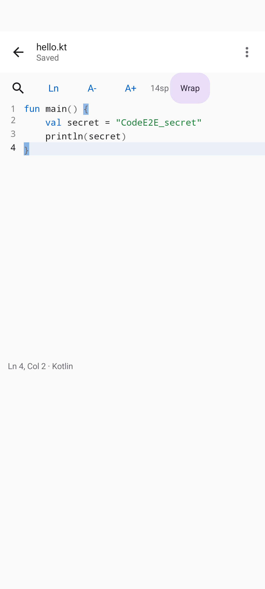

# NoteZero


**Offline-first, end-to-end encrypted notes and code editor for Android.**
No account. No cloud. No network permission. Your notes never leave the device except
through an encrypted backup file you export yourself.

NoteZero is the second Cipherwell app, built to the same security bar as
[VaultZero](https://github.com/cipherwell/Vault-Zero) with an independent package
(`com.cipherwell.notezero`), independent signing key and independent threat model.

> Status: **Phase 2 complete + Phase 3 started** — 2026-11-15.
> Security core, notes MVP, encrypted SAF backup/restore and the code editor are in;
> builds green, **533 unit tests + 10 device tests**, signed release verified.
> What ships now and what is deliberately next:
> [docs/VERIFICATION-2026-11-15.md](docs/VERIFICATION-2026-11-15.md). Delivery phases: [SPEC.md](SPEC.md).


## What exists today

| Setup (first run) | Unlock | Notes MVP |
|---|---|---|
|  |  |  |
| **Markdown editor** | **Block preview (checklists tap to toggle)** | **Second note persisted** |
|  |  |  |
| **Encrypted backup (SAF)** | **Code workspace (file tree)** | **Kotlin editor (syntax highlighting)** |
|  |  |  |

Screenshots are real emulator captures from the instrumented E2E run (debug build with
`-PallowScreenshots=true`; normal builds set FLAG_SECURE, which makes `screencap` return a
0-byte file — verified).

## Verified end to end (2026-11-15)

- 533 unit tests / 0 failures (43 classes); 10 instrumented tests on a real emulator.
- Real Android crypto: setup → BIP-39 phrase → lock/unlock; **password change leaves note
  ciphertext byte-identical**; recovery reset invalidates the old password; a raw SQLite scan
  of the database files (main + WAL + SHM) finds no plaintext title/body/phrase — including a
  code file created through the code editor.
- SAF encrypted backup/restore is wired end to end: the picker's background stop no longer
  locks the vault (deferred, idle timeout still applies), exports are vault-key or
  separate-password protected, imports are duplicate-safe and accept a source master password
  or 12-word phrase for cross-vault restores.
- Code editor: pure-Kotlin lexers for Kotlin/Java/JS/TS/Python/JSON/XML/Markdown/Shell
  (200 KB in ~3–8 ms measured), file tree, line numbers, syntax colours, auto-indent,
  bracket matching, find/replace, go-to-line, undo/redo, font size/wrap, 600 ms autosave.
- FLAG_SECURE default-on proof; release APK permission dump: only `USE_BIOMETRIC` (+
  androidx.core's signature-level receiver guard) — no network, camera, location or storage.
- Signed release verified with the independent NoteZero upload key; unsigned-release fallback
  for F-Droid also verified.
- Full evidence trail incl. commands and hashes:
  [docs/VERIFICATION-2026-11-15.md](docs/VERIFICATION-2026-11-15.md).

## Security properties (by construction)

- **No network permissions.** `INTERNET` and `ACCESS_NETWORK_STATE` are stripped from the
  merged manifest with `tools:node="remove"` (plus the deprecated `USE_FINGERPRINT` the
  biometric library drags in), no network library is a dependency, and
  `scripts/check-offline.sh` + `OfflineGuaranteeTest` fail the build if that changes.
  The only app permission left is `USE_BIOMETRIC` plus `androidx.core`'s signature-level
  dynamic-receiver guard.
- **Random 256-bit vault master key (VMK).** Notes are AES-256-GCM encrypted under the
  VMK; the VMK is only ever wrapped by your password/recovery phrase, never derived from
  them. Changing the master password re-wraps the VMK and does **not** re-encrypt notes.
- **Per-item AAD.** Every ciphertext is bound to its item id and type, so a row cannot be
  swapped between notes/vaults without failing authentication.
- **Redacted storage.** Titles, tags, folder names, bodies and flags live *inside* the
  encrypted envelope. Room columns hold only random ids, kinds, timestamps and ciphertext.
- **PBKDF2-HMAC-SHA256, 600,000 iterations**, 128-bit salts, versioned KDF slot so
  Argon2id can be added without breaking existing vaults.
- **12-word BIP-39 recovery phrase** (128-bit entropy, checksum validated, unique words).
- **Hardware biometric unlock** via Android Keystore, per-use CryptoObject, invalidated by
  re-enrolment.
- **Auto-lock** on background/screen-off/timeout; sensitive clipboard handling; FLAG_SECURE.
- **Encrypted backup** export/restore through the Storage Access Framework only.
- **No telemetry, analytics, ads, accounts or third-party sync.**

See [docs/CRYPTO-SPEC.md](docs/CRYPTO-SPEC.md), [docs/THREAT-MODEL.md](docs/THREAT-MODEL.md),
[docs/DECISIONS.md](docs/DECISIONS.md) and [SECURITY.md](SECURITY.md).

## Build

Requires JDK 17 and Android SDK 36 (`compileSdk 36`, `minSdk 24`).

```bash
export JAVA_HOME=/usr/lib/jvm/java-17-openjdk   # JDK 17 is mandatory, 21+ not supported by AGP 9.1
./scripts/gen-debug-keystore.sh                 # local debug key (gitignored)
./gradlew :app:assembleDebug
./gradlew :app:testDebugUnitTest                # 290 tests, 0 failures (2026-11-15)
./scripts/check-offline.sh                      # offline guarantee check
```

Full instructions (including signed release builds and this machine's exact setup):
[docs/BUILDING.md](docs/BUILDING.md).

## Docs

| Document | Contents |
|---|---|
| [SPEC.md](SPEC.md) | Product specification and delivery phases |
| [docs/DECISIONS.md](docs/DECISIONS.md) | Frozen first-session decisions incl. signing key fingerprint |
| [docs/CONTRACTS.md](docs/CONTRACTS.md) | Module contracts, ownership, crypto/data/UI interfaces |
| [docs/CRYPTO-SPEC.md](docs/CRYPTO-SPEC.md) | Primitives, key hierarchy, envelope formats, AAD map |
| [docs/THREAT-MODEL.md](docs/THREAT-MODEL.md) | Assets, adversaries, mitigations, out-of-scope |
| [docs/ARCHITECTURE.md](docs/ARCHITECTURE.md) | Layers, Room schema, session/lock lifecycle |
| [docs/DATA-MODEL.md](docs/DATA-MODEL.md) | Item/folder envelopes, redaction model |
| [docs/BACKUP-FORMAT.md](docs/BACKUP-FORMAT.md) | Encrypted backup envelope format |
| [docs/BUILDING.md](docs/BUILDING.md) | Toolchain, debug/release, signing, reproducibility |
| [docs/TESTING.md](docs/TESTING.md) | Test strategy and commands, measured baseline |
| [docs/CONTRACTS-PHASE3.md](docs/CONTRACTS-PHASE3.md) | Phase-2/3 increment contracts (backup UI, editor engine/UI) |
| [docs/EDITOR-SPEC.md](docs/EDITOR-SPEC.md) | Code editor languages, tokens, editing behaviour, performance |
| [docs/VERIFICATION-2026-11-15.md](docs/VERIFICATION-2026-11-15.md) | Phase-1 evidence: builds, 290 unit tests, device E2E, signing, FLAG_SECURE |
| [docs/DEPENDENCIES.md](docs/DEPENDENCIES.md) | Dependency policy/inventory (offline-safe only) |
| [docs/RELEASING.md](docs/RELEASING.md) | Release checklist, F-Droid eligibility |

## License

MIT — see [LICENSE](LICENSE). NoteZero is independent from VaultZero; they share design
patterns and test vectors, not code signing identity or product identity.
